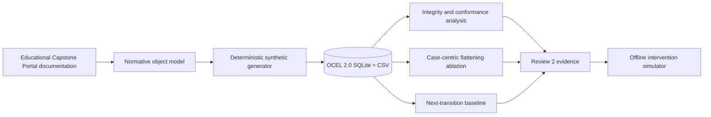

# Object-Centric Event Log Mining for Academic Capstone Processes


> **Research status:** Review 2 proof of mechanism. Every dataset and numerical result in this repository is synthetic. This repository contains no production Educational Capstone Portal logs, real capstone PDFs, or measured institutional outcomes.

This Team 1 project investigates whether a native [OCEL 2.0](https://www.ocel-standard.org/2.0/) representation can preserve and analyse the interacting entities in an academic capstone lifecycle: projects, teams, students, faculty, review stages, report versions, and scores.

The repository combines the research design, Educational Capstone Portal documentation baseline, a deterministic synthetic benchmark, analysis outputs, Review 2 deliverables, and an interactive professor-facing demonstration.

## Research question

Conventional process mining normally selects one case identifier. A capstone event may simultaneously concern a project, three students, a guide, a review stage, a versioned report, and an immutable score. The central question is:

**Which process relationships and risk predicates become unobservable when this multi-entity lifecycle is flattened to one case notion?**

## Proposed contributions

1. A native OCEL 2.0 model for the transactional academic-capstone lifecycle.
2. A documentation-grounded validation triad joining a normative model, descriptive process analysis, and adversarial synthetic cases.
3. Capstone-specific cross-object conformance rules for stage progression, retry limits, capacity, score lockout, duplicate verification, and counter skew.
4. **Cross-Object Observability Coverage (COOC)**, a study-specific metric measuring how many preregistered cross-object predicates remain computable and oracle-correct in a representation.
5. An offline digital-twin experiment for comparing attempt-policy and faculty-capacity interventions before any platform change.

COOC is proposed as a study-specific evaluation measure, not as a universal OCEL quality standard. The project does **not** claim to be the first use of object-centric process mining in education.

## Review 2 results

| Experiment | Synthetic result |
|---|---:|
| Project-centric relation retention | 27.9% |
| Student-centric relation retention | 19.8% |
| Report-version-centric relation retention | 26.3% |
| Native OCEL relation retention | 100.0% |
| Flat-log COOC range | 16.7–50.0% |
| Native OCEL COOC | 100.0% (6/6 predicates) |
| Deterministic anomaly detector macro-F1 | 0.977 |
| Markov next-transition top-1 / top-2 accuracy | 0.912 / 0.986 |
| Combined intervention: modelled deadlock | 11.2% → 1.3% |
| Combined intervention: modelled completion | 74.5% → 89.5% |

These values validate the implementation under controlled assumptions. They do not estimate real Educational Capstone Portal defect rates, predictive performance, or causal intervention effects.

## Research pipeline



## Repository layout

```text
.
├── demo/                   Interactive Review 2 frontend
├── docs/
│   ├── research/           Literature review, agenda, execution prompt, and novelty plan
│   ├── review-1/           Team 1 Review 1 presentation
│   ├── review-2/           Presentation, draft report, and explanation guide
│   └── educational-capstone-platform/  Documentation used to derive the process model
├── synthetic/
│   ├── src/                Dependency-free Python generator and analysis
│   ├── data/               Three generated scenarios and OCEL databases
│   └── results/            CSV/JSON experiment outputs
├── scripts/                Repository-level validation
└── .github/workflows/      Reproducibility and frontend build checks
```

## Reproduce the synthetic study

Python 3.10 or newer is sufficient; the research pipeline uses only the Python standard library.

```bash
python3 synthetic/src/team1_synthetic_ocel.py
python3 synthetic/src/analyze_team1_synthetic.py
python3 scripts/check_package.py
```

Default configuration: seed `4971`, 120 projects per scenario, 30 faculty, and three students per team.

## Run the Review 2 demo

The frontend requires Node.js 22.13+ and pnpm.

```bash
cd demo
pnpm install --frozen-lockfile
pnpm dev
```

Open `http://localhost:3000`. The demo uses packaged results and does not require Educational Capstone Portal access or an internet connection after dependencies have been installed.

## Scenarios

- `clean_target`: intended R1–R2–R3 lifecycle.
- `implemented_baseline`: documented currently implemented R1-only progression.
- `gap_injected`: intended lifecycle plus controlled and labelled edge-case injections.

## Path to a journal claim

Before publication, the team should preregister the schema, predicates, baselines, and analysis; validate on de-identified real Educational Capstone Portal logs; obtain independent expert labels; report inter-rater agreement; run multi-seed and missingness sensitivity analyses; and, if possible, test a second institution or academic workflow.

## Team

| Member | Registration number |
|---|---|
| Aakaash Sathya Saravanan | 23BCE0500 |
| Mitisha Sharma | 23BCE0434 |
| Tanmay Khambete | 23BCE0498 |

Project guide: **Dr. Kalyanaraman P.**

## Key references

- [OCEL 2.0 specification](https://www.ocel-standard.org/2.0/ocel20_specification.pdf)
- [van der Aalst, Object-Centric Process Mining (2019)](https://doi.org/10.1007/978-3-030-30446-1_1)
- [Park and van der Aalst, Proc. ICPM (2021)](https://doi.org/10.1109/ICPM53251.2021.9576846)
- [Miri et al., multi-entity educational process mining (2026)](https://doi.org/10.1016/j.dajour.2026.100724)

## Responsible use

Do not add real student, faculty, score, submission, or capstone-document data to this repository. See [SECURITY.md](SECURITY.md) before connecting the pipeline to institutional data.
