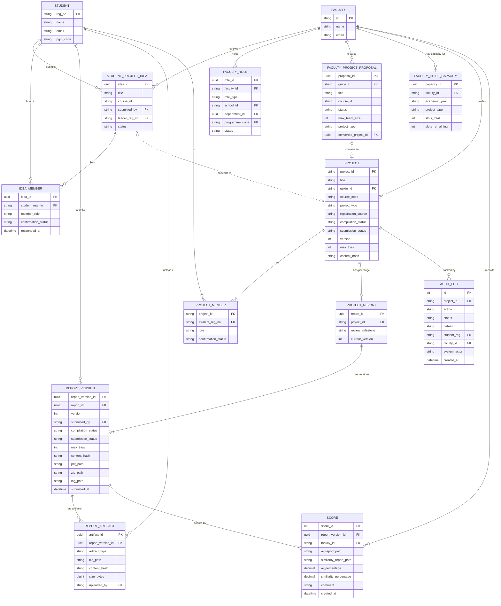

# Educational Capstone Portal — Domain Model (Entity-Relationship Diagram)

This ER diagram documents the core entities of the Educational Capstone Portal domain, their attributes, and
their cardinality relationships. It covers both the legacy model layer (`app/models/*`) and the
new modular model layer (`app/modules/*/models/*`) in their post-migration target form. Where
entities exist in both layers with different structures, the new modular form is shown as the
canonical representation.

---

## Notes

- **Two model layers coexist during migration**: the legacy `app/models/project.py:Project`
  and `app/models/score.py:Score` are still used by the live state machine. The new modular
  entities (`ProjectReport`, `ProjectReportVersion`, `Score` in `app/modules/reports/models/`)
  are the target post-migration form. This ER diagram shows the **new modular form** as the
  authoritative schema.
- **`registration_source`** on `PROJECT` records the origin path:
  `faculty_proposal | student_idea | manual`.
- **`REPORT_ARTIFACT.artifact_type`** is constrained to
  `{ppt, poster, sdg_plan, outcome_plan, outcome_status, outcome_attainment_proof}`. There is
  **no `source_code` artifact type** — Stage-3 source code is the uploaded ZIP stored as
  `REPORT_VERSION.zip_path`, not a separate artifact record.
- **`FACULTY_ROLE.role_type`** is constrained to
  `{hod, dean, project_coordinator, panel_member, guide}`. Only `guide` is relevant to the
  project registration and submission workflows described in the prose requirements.
- **`SCORE` model**: the new schema stores `ai_report_path` and `similarity_report_path` (file
  paths for manually uploaded Turnitin PDFs), plus nullable `ai_percentage` and
  `similarity_percentage`. There is **no `is_editable` column** and **no separate
  edited-value storage** — a Gap from the requirements.
- **`FACULTY_GUIDE_CAPACITY`**: tracks guide slot allocation per
  `(faculty_id, academic_year, project_type)`. Decremented by the `ProjectConfirmed` event
  handler. The current implementation silently permits over-allocation on handler failure.

---

## Business Rules

| Relationship | Cardinality | Enforcement |
|---|---|---|
| Student → Idea | 0 or many (logically 1 active) | Application layer; no DB unique constraint observed |
| Idea → Project | 0 or 1 | `status = converted_to_project ⇔ converted_project_id IS NOT NULL` (DB constraint) |
| Proposal → Project | 0 or 1 | Same invariant as above |
| Project → Members | 1 or many | At least a leader must exist |
| Project → ProjectReport | 1 per stage (0–3 rows) | `UNIQUE(project_id, review_milestone)` |
| ProjectReport → Versions | 1 or many | `UNIQUE(report_id, version)`; `version ≥ 1` |
| ReportVersion → Scores | 0 or many | `UNIQUE(report_version_id, faculty_id)` — one per examiner |
| Score | Immutable once written | `SERIALIZABLE` transaction + unique constraint |

- `IDEA_MEMBER.confirmation_status ∈ {pending, confirmed, removed}` with DB constraint:
  `(confirmation_status = 'pending') OR (responded_at IS NOT NULL)`.
- `PROJECT_MEMBER.role ∈ {leader, member}`; `confirmation_status ∈ {pending, confirmed}`.
- `REVIEW_ARTIFACT.artifact_type` is constrained by DB `CHECK` — no free-form types allowed.
- `SCORE.ai_percentage` and `similarity_percentage` must be in `[0, 100]` or `NULL` (new schema).

---

## Edge Cases

- **Student in multiple projects**: `PROJECT_MEMBER` uses `(project_id, student_reg_no)` as a
  composite primary key. Nothing at the DB level prevents the same `student_reg_no` from
  appearing in two different `project_id` rows. The "one team per student" rule relies on
  application-layer checks only.
- **`converted_project_id` orphan**: if the project created from an idea or proposal is later
  deleted, the `converted_project_id` FK becomes a dangling reference (unless `ON DELETE` is
  configured — not observed in the current model).
- **`AUDIT_LOG.faculty_id` is not a FK in the legacy model**: the legacy `AuditLog` model
  stores `faculty_id` as a plain `String`, not a foreign key. Referential integrity is not
  enforced for audit entries — a faculty record may be deleted while audit logs retain their ID.
- **`REPORT_VERSION.max_tries` vs `PROJECT.max_tries`**: both fields exist and must be kept
  in sync during the migration period. A partial write (one updated, other rolled back) leaves
  them inconsistent.
- **`SCORE` nullable percentages**: a `Score` record can be written with `ai_percentage = NULL`
  and `similarity_percentage = NULL` (new schema). This means a submission can be formally
  "scored" by a faculty member without any numeric values, which may satisfy the unique
  constraint and block a legitimate score entry later.
