# Educational Capstone Portal — Enterprise Swimlane Diagram

This swimlane diagram maps every actor's responsibilities across the complete Educational Capstone Portal project
lifecycle. Each vertical lane represents one actor or system component. Horizontal arrows
represent handoffs between lanes. The diagram is intended for enterprise architects and
project managers who need to understand actor boundaries and integration points.

```mermaid
flowchart LR
    subgraph STU["Student"]
        direction TB
        s_auth([Google OAuth Login])
        s_idea[Create Project Idea\nSelect Team Members]
        s_confirm[Respond to\nMember Invitations]
        s_guide_select[Select Faculty Guide]
        s_upload[Upload Report ZIP\nAll Stages]
        s_preview[Preview Compiled Report\nEdit and Re-run Freely]
        s_submit[Submit Report to Faculty]
        s_resubmit[Resubmit After Rejection\nor for Next Stage]
        s_notified[Receive Decision Notification]
    end

    subgraph FAC["Faculty"]
        direction TB
        f_auth([Google OAuth Login])
        f_prop[Create Project Proposal\nAssign Team and Leader]
        f_idea_review{Approve or Reject\nStudent Idea?}
        f_open[Open Submission\nunder_verification]
        f_review[Review Compiled PDF\nand Artifacts]
        f_upload_report[Upload Turnitin Report\nManual Score Entry]
        f_decide{Approve or\nReject Submission?}
    end

    subgraph ADM["Admin"]
        direction TB
        a_login([Admin Login])
        a_review{Approve or Reject\nFaculty Proposal?}
        a_manage[Manage Users\nFaculty and Students\nCSV Bulk Upload]
        a_vis[Manage Visibility Locks\nPer Academic Semester]
    end

    subgraph POR["Portal"]
        direction TB
        p_oauth[Handle Google OAuth\nJWT Issuance]
        p_guard[State Transition Guards\nCompilation and Submission Status]
        p_rate[Rate Limiter\nPer-Student Upload Limit]
        p_notify[Notification Service\nIn-App Notifications via Event Bus]
        p_audit[Audit Logger\nAll State Changes]
        p_sse[SSE Stream\nReal-Time Compile Status]
        p_lock[Score Lock\nSERIALIZABLE Transaction]
    end

    subgraph PROC["Processing Services"]
        direction TB
        pr_type[File Type Check\n.zip only]
        pr_size[Size Check\nMax Compressed Size]
        pr_bomb[ZIP-Bomb Detection\nDecompression Ratio]
        pr_trav[Path-Traversal Check\nAll ZIP Entries]
        pr_mal["Malware Scan — Gap\nNot Implemented"]
        pr_vuln["Vulnerability Scan — Gap\nNot Implemented"]
        pr_hash[Content Hash\nSHA-256 Cache Key]
        pr_queue[Redis Task Queue\nEnqueue Compile Job]
        pr_celery[Celery Worker\nLaTeX Compilation]
        pr_pdf[PDF and Artifacts\nGenerated in Temp Workspace]
        pr_persist[Move to Persistent Storage\nOn Student Submission]
    end

    %% ── Registration Phase ──

    s_auth --> p_oauth
    f_auth --> p_oauth
    a_login --> p_oauth

    s_idea --> s_confirm
    s_confirm -->|"Idea submitted by leader"| f_idea_review

    f_idea_review -->|"Approved — ProjectConfirmed"| p_notify
    f_idea_review -->|"Rejected — full restart"| s_auth

    f_prop -->|"Proposal submitted"| a_review
    a_review -->|"Approved — ProjectConfirmed"| p_notify
    a_review -->|"Rejected"| f_auth

    s_guide_select --> f_idea_review
    p_notify --> s_notified

    %% ── Processing Pipeline ──

    s_upload --> p_rate --> pr_type --> pr_size --> pr_bomb --> pr_trav
    pr_mal -.->|"Gap"| pr_trav
    pr_vuln -.->|"Gap"| pr_trav
    pr_trav -->|"Invalid"| s_upload
    pr_trav -->|"Valid"| pr_hash

    pr_hash -->|"Cache hit"| pr_pdf
    pr_hash -->|"Cache miss"| pr_queue --> pr_celery --> pr_pdf
    pr_pdf --> p_sse --> s_preview --> s_submit

    %% ── Submission and Review ──

    s_submit --> p_guard
    p_guard --> f_open --> f_review --> f_upload_report --> f_decide
    p_guard --> p_audit

    f_decide -->|"Approved"| p_lock --> p_audit
    f_decide -->|"Rejected — attempts--"| p_notify
    p_notify --> s_resubmit --> s_upload

    pr_persist --> f_open
    s_submit --> pr_persist

    %% ── Finalization ──
    f_decide -->|"R3 Approved"| FINAL["Project Finalized\nScores Locked\nProject Locked"]

    classDef authStyle fill:#0d6efd,stroke:#0a58ca,color:#ffffff
    classDef termStyle fill:#198754,stroke:#157347,color:#ffffff
    classDef failStyle fill:#dc3545,stroke:#b02a37,color:#ffffff
    classDef gapStyle fill:#fd7e14,stroke:#d96a0b,color:#000000
    classDef sysStyle fill:#343a40,stroke:#1a1d20,color:#ffffff
    classDef decStyle fill:#6f42c1,stroke:#59359a,color:#ffffff

    class s_auth,f_auth,a_login authStyle
    class FINAL termStyle
    class pr_mal,pr_vuln gapStyle
    class p_oauth,p_guard,p_audit,p_lock,p_sse,p_notify sysStyle
    class f_idea_review,a_review,f_decide decStyle
```

---

## Notes

- **Lane arrangement** (left to right): `Student` → `Faculty` → `Admin` → `Portal` → `Processing
  Services`. Horizontal arrows represent actor-to-actor handoffs. Within each lane, nodes flow
  top-to-bottom following the natural process timeline.
- **Portal lane** represents the API and infrastructure layer: OAuth gateway, state transition
  guards, rate limiter, notification service, audit logger, SSE stream, and score-lock
  transaction. It is not a human actor but a system boundary.
- **Processing Services lane** breaks down the validation and compilation pipeline into discrete
  checks. Malware and vulnerability scanning appear with `Gap` labels and dotted connections to
  show their intended position in the pipeline.
- **Mermaid limitation**: Mermaid does not support true swimlane diagrams. This diagram uses
  `flowchart LR` with `direction TB` inside each subgraph to approximate swimlane behaviour.
  Cross-lane arrows may not always be perfectly horizontal in all renderers.
- **Admin lane** shows three responsibilities: proposal approval, user management (CSV bulk
  upload of students/faculty), and visibility locks (semester-level access control). The latter
  two are present in the codebase but absent from the prose requirements.

---

## Business Rules

- **Student**: can only initiate one idea and belong to one team at a time; only the leader
  may call the submit-idea endpoint.
- **Faculty**: must hold `role_type = 'guide'` (active) to create a proposal; acts as the
  sole approver for student ideas; acts as the sole approver for stage submissions.
- **Admin**: approves or rejects faculty proposals; manages user accounts and visibility locks.
  Admin cannot directly approve stage submissions.
- **Portal**: enforces all state machine guards before passing control to the next actor.
  All transitions are logged to `AuditLog` before returning a response.
- **Processing Services**: validate ZIP structure and safety; compile LaTeX; deliver PDF. Do
  not make human decisions. Malware/vulnerability scan integration is a Gap.
- **Score locking** (Portal lane): once a score is written for a `(report_version_id,
  faculty_id)`, it is immutable. The `SERIALIZABLE` isolation level prevents concurrent
  writes from creating duplicate score records.

---

## Edge Cases

- **Actor boundary crossing**: a faculty member who is also an admin can approve their own
  proposal. No system-level conflict-of-interest guard is implemented.
- **Notification service failure**: the `ProjectConfirmed` event handler wraps the notification
  enqueue in a try/except and commits regardless. A failed notification does not block project
  creation but leaves stakeholders uninformed.
- **Admin visibility lock during active submission**: an admin can lock a semester while
  students have active submissions in progress. The interaction between visibility locks and
  in-flight state machine transitions is not defined.
- **Parallel paths converging at Processing Services**: both the student-idea approval path
  and the faculty-proposal approval path reach the upload pipeline independently. The
  processing pipeline treats both identically since it only sees `project_id`.
