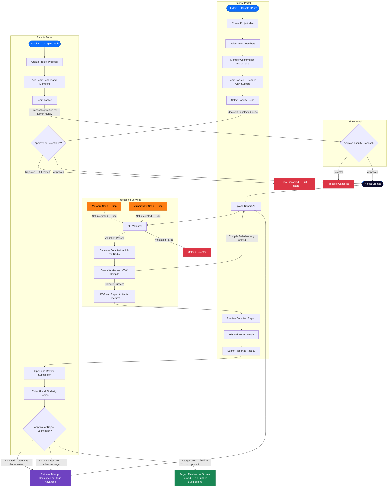

# Educational Capstone Portal — Executive Overview

This diagram presents the complete end-to-end lifecycle of the Educational Capstone Portal: both project
registration paths (student-initiated and faculty-initiated), the report processing pipeline,
the three-stage submission lifecycle, and project finalization. It is intended as a
non-technical entry point for stakeholders and a navigation map for engineers.

---

## Notes

- **Two independent registration paths** both converge on `Project Created`. The student path
  requires a faculty guide's manual approval; the faculty path requires admin approval.
- **Processing Services** are invoked on every upload attempt. The ZIP Validator enforces
  type, size, rate-limiting, ZIP-bomb ratio, and path-traversal guards inline (no external
  service call). Malware scanning and vulnerability scanning are specified requirements that
  have **no implementation** — marked `Gap`.
- **The submission loop** (upload → compile → preview → submit) repeats unlimited times before
  first faculty submission. After a faculty rejection, one attempt is consumed; after R1 or R2
  approval, the stage advances and the loop restarts for the next milestone.
- **OCR score extraction and Turnitin integration** are omitted here for clarity; they appear
  in the Faculty Review Workflow diagram with their implementation status.
- **Project Finalized** is a hard terminal state. No further uploads, submissions, or score
  edits are permitted once R3 is approved.

---

## Business Rules

- One active idea per student; one team per student (enforced at application layer).
- Only the team leader may submit the idea (HTTP 403 for non-leaders).
- Team size is capped at `max_team_size` (≤ 10) as defined on the faculty proposal.
- Maximum **3 attempts per stage** (`max_tries = 3`); each faculty rejection decrements by one.
- Compilation failures do **not** consume an attempt — only faculty rejections do.
- A student may recompile unlimited times before submitting to faculty.
- `submit_for_review` requires `compilation_status == SUCCESS`; any other state raises an error.
- Scores are written under a `SERIALIZABLE` transaction and are **immutable** once recorded per version.

---

## Edge Cases

- **Attempts exhausted (`max_tries == 0`)**: the faculty `reject_submission` call raises a
  `ValueError`; the project becomes stuck in `UNDER_VERIFICATION` with no automated escape.
  Manual intervention is required — this state is undefined in the current implementation.
- **Guide capacity overrun**: if a guide's capacity slot is already full when `ProjectConfirmed`
  fires, the capacity decrement logs a warning but the project is confirmed anyway (no rollback).
- **Guide reassignment mid-submission**: a `GuideReassigned` event exists but its effect on
  in-progress submissions and locked scores is undefined.
- **Concurrent upload guard**: a `SELECT FOR UPDATE` lock and `PROCESSING` state check prevent
  double uploads, but the guard relies on the legacy `Project` model during the active migration.
