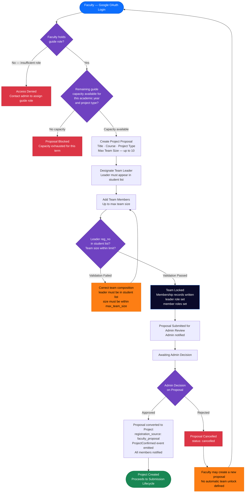

# Educational Capstone Portal — Faculty Project Registration Workflow

This diagram details the faculty-initiated project registration path: from Google OAuth login
through proposal creation, team assignment, team locking, and the admin approval gate. A
faculty member may hold one of several roles (`guide`, `hod`, `dean`, `project_coordinator`,
`panel_member`); only the `guide` role is relevant to this path.

---

## Notes

- **Faculty role model**: a single faculty member may hold multiple roles scoped to different
  organisational units (`school_id`, `department_id`, `programme_code`). The `guide` role is
  required to create a proposal; the `hod` and `project_coordinator` roles are used in review
  event and mark management workflows (see coordinator diagrams).
- **Capacity enforcement**: `FacultyGuideCapacity` is checked per `(faculty_id, academic_year,
  project_type)`. Capacity is decremented on `ProjectConfirmed`. The check at proposal time is
  advisory; the decrement on confirmation is the binding gate (and can warn without blocking in
  the current implementation).
- **Admin approval path**: the proposal's `status` enum allows `open → converted_to_project`
  (admin approves) or `open → cancelled` (admin rejects). The `closed` status is a third option
  (admin manually closes without conversion).
- **No member confirmation handshake**: unlike the student-idea path, the faculty proposal path
  does **not** implement a `pending/confirmed` confirmation step for team members. Members are
  added directly.
- **`ProjectConfirmed` event**: fires on admin approval, decrements guide capacity, and enqueues
  in-app notifications for the guide and all team members.
- **Rejection path gap**: what happens to team members after a proposal cancellation is not
  defined. Whether students remain locked to this cancelled proposal or are freed is unspecified.

---

## Business Rules

- Faculty must hold an active `guide` role (`faculty_roles.role_type = 'guide'`,
  `status = 'active'`) to create a proposal.
- `leader_reg_no` must appear in `student_reg_nos`; omitting the leader raises a validation
  error (`ValueError: leader_reg_no must be in student_reg_nos`).
- Team size cannot exceed `max_team_size` as defined on the proposal (maximum 10 per
  the database `CHECK` constraint).
- Proposal `status` transitions: `open → converted_to_project` (admin approves, with
  `converted_project_id` set) or `open → cancelled`. The invariant
  `(status = 'converted_to_project') = (converted_project_id IS NOT NULL)` is database-enforced.
- `registration_source` on the created project is set to `faculty_proposal`.
- Guide capacity is decremented per `(academic_year, project_type)` on project confirmation.

---

## Edge Cases

- **Admin rejection path not fully specified**: the prose requirements only describe the approval
  branch. The `cancelled` status is confirmed in code, but no explicit "notify faculty of
  rejection" step or "release team members" step is implemented.
- **Capacity overrun on concurrent approvals**: if two proposals by the same guide are approved
  simultaneously, the capacity decrement may succeed for both (race condition). The decrement
  uses a best-effort approach and logs a warning rather than aborting the confirmation.
- **Guide reassignment post-creation**: a `project_guide_reassignment` table and `GuideReassigned`
  event exist for post-creation reassignments, but the effect on the proposal flow (and on
  capacity accounting for the old and new guides) is not fully specified.
- **Proposal in `open` state indefinitely**: there is no timeout or auto-cancellation for
  proposals awaiting admin review. A proposal can remain `open` indefinitely.
