# Educational Capstone Portal — Faculty Review Workflow

This diagram covers the faculty review process after a student submits a report: opening the
submission, uploading a Turnitin-style report, score recording (currently manual), optional
score correction with audit trail, and the approve/reject decision. Planned OCR extraction
and Turnitin integration are marked explicitly.

```mermaid
flowchart TD
    START(["Submission Received\nsubmission_status: submitted\nFaculty notified"])

    START --> OPEN[Faculty Opens Submission\nPOST start_verification\nsubmission_status: under_verification]

    OPEN --> REVIEW[Faculty Reviews Compiled PDF\nDownloads report artifacts]

    REVIEW --> UPLOAD[Faculty Uploads Turnitin Report\nPDF report stored at similarity_report_path\nand or ai_report_path]

    UPLOAD --> EXTRACT

    subgraph SCORING["Score Recording"]
        direction TB

        EXTRACT{"How are scores\nextracted?"}

        MANUAL[Faculty Manually Enters Scores\nai_percentage — 0 to 100\nsimilarity_percentage — 0 to 100\nOptional comment]

        OCR_PLANNED["OCR Service Extracts Scores — Planned\nParse Turnitin PDF\nExtract ai_percentage\nExtract similarity_percentage\nAuto-populate fields"]

        TINT_PLANNED["Turnitin API Integration — Planned\nDirect API call to Turnitin\nReceive structured score response\nNo manual report upload needed"]

        EDITABLE["Manual Override of OCR Result — Planned\nFaculty edits extracted values\nEdited values stored separately — Gap\nis_editable flag set to true — Gap\nEdit recorded in audit log — Gap"]

        STORE[Scores Stored in Database\nOne score record per report_version_id\nand faculty_id\nImmutable once written]
    end

    EXTRACT -->|"Current Implementation"| MANUAL
    EXTRACT -.->|"Planned"| OCR_PLANNED
    EXTRACT -.->|"Planned"| TINT_PLANNED
    OCR_PLANNED -.->|"Planned"| EDITABLE
    TINT_PLANNED -.->|"Planned"| EDITABLE
    EDITABLE -.->|"Planned"| STORE
    MANUAL --> STORE

    STORE --> AUDIT[Audit Log Entry Created\naction: SCORE_RECORDED\nfaculty_id + project_id + version]

    AUDIT --> LOCKED{"Score Already\nRecorded for This\nVersion?"}

    LOCKED -->|"Yes — score immutable"| LOCKERR["HTTP 400 — Scores are Locked\nSerializable transaction enforces\none score per version per faculty"]

    LOCKED -->|"No — score accepted"| DECIDE

    DECIDE{"Faculty Decision\non Submission"}

    DECIDE -->|"Approve"| APPROVE
    DECIDE -->|"Reject"| REJECT

    APPROVE[Faculty Approves Submission\nPOST accept_submission\nsubmission_status: accepted]
    APPROVE --> APAUDIT[Audit Log: FACULTY_ACCEPTED]
    APAUDIT --> APNOTIFY[Student Notified — Submission Approved]
    APNOTIFY --> APCHECK{"Is this the\nfinal stage R3?"}
    APCHECK -->|"No — R1 or R2"| NEXTSTAGE["Advance to Next Stage\nGap: not yet wired in state machine"]
    APCHECK -->|"Yes — R3"| FINALIZE["Project Finalized\nAll scores locked\nProject locked — no further submissions"]

    REJECT[Faculty Rejects Submission\nPOST reject_submission\nProvide rejection remarks]
    REJECT --> REJMQ{"max_tries > 0?"}
    REJMQ -->|"Yes — attempts remain"| REJOK["submission_status: not_submitted\ncompilation_status: idle\nattempts-- · version++"]
    REJMQ -->|"No — exhausted"| REJFAIL["ValueError raised\nProject stuck in under_verification\nNo escape path — Gap"]
    REJOK --> REJAUDIT[Audit Log: FACULTY_REJECTED]
    REJAUDIT --> REJNOTIFY[Student Notified — Submission Rejected\nRemarks included]
    REJNOTIFY --> RELOOP["Student Re-uploads and Resubmits\nNew compilation cycle begins"]

    classDef planStyle fill:#fd7e14,stroke:#d96a0b,color:#000000
    classDef termStyle fill:#198754,stroke:#157347,color:#ffffff
    classDef failStyle fill:#dc3545,stroke:#b02a37,color:#ffffff
    classDef gapStyle fill:#7b2d00,stroke:#4d1a00,color:#ffe5a0
    classDef decStyle fill:#6f42c1,stroke:#59359a,color:#ffffff
    classDef storeStyle fill:#003566,stroke:#001d3d,color:#cce5ff

    class OCR_PLANNED,TINT_PLANNED,EDITABLE planStyle
    class FINALIZE termStyle
    class REJFAIL,LOCKERR failStyle
    class DECIDE,LOCKED,APCHECK,REJMQ decStyle
    class STORE,AUDIT storeStyle
```

---

## Notes

- **Score recording is entirely manual** in the current implementation. Faculty types
  `ai_percentage` and `similarity_percentage` directly into the form. There is no automated
  extraction from uploaded documents.
- **Turnitin integration is Planned**: no Turnitin API client, webhook, or report parser exists
  in the codebase. The `ai_report_path` and `similarity_report_path` columns store the file
  paths of manually uploaded report PDFs.
- **OCR extraction is Planned**: the requirement states "OCR extracts scores automatically" but
  no OCR library, service call, or parsing logic exists. Zero matches for `ocr`, `tesseract`,
  or any OCR-related term in the codebase.
- **`is_editable` flag and separate edited-value storage are a Gap**: the `Score` model has no
  `is_editable` column and no mechanism to store "before edit" and "after edit" values
  separately. The requirement to "store edited values separately" and "mark `is_editable = true`"
  is unimplemented.
- **Score immutability**: the new `Score` model enforces `UNIQUE(report_version_id, faculty_id)`.
  A second write attempt returns HTTP 400 ("Scores are locked"). The legacy `Score` model uses
  `UNIQUE(project_id, version)` with a `SERIALIZABLE` transaction for the same effect.
- **Audit trail for score corrections is a Gap**: the general `AuditLog` captures submission
  decisions, but score-specific correction history (old value → new value, who changed it, when)
  is not separately tracked.

---

## Business Rules

- `start_verification` (opening the submission) requires `submission_status == SUBMITTED`.
- `accept_submission` and `reject_submission` both require `submission_status == UNDER_VERIFICATION`.
- `ai_percentage` and `similarity_percentage` must be in the range `[0, 100]` (database `CHECK`
  constraints on both legacy and new `Score` models).
- One score record per `(report_version_id, faculty_id)` — the unique constraint makes scores
  immutable after the first write.
- `reject_submission` raises a `ValueError` when `max_tries ≤ 0`; the faculty UI must expose
  the current attempt count to prevent the faculty from initiating an impossible rejection.
- On approval, scores for the accepted version are considered finalized for that stage.
- All faculty decisions (accept, reject, verification open) are written to `AuditLog` with
  `faculty_id`, `project_id`, action string, and timestamp.

---

## Edge Cases

- **Score lock conflict**: if two faculty members (e.g., guide + panel member) both attempt to
  write a score for the same `(report_version_id, faculty_id)` concurrently, only the first
  write succeeds; the second receives a unique constraint violation.
- **Turnitin report uploaded but scores not entered**: nothing prevents a faculty member from
  uploading the report file without entering scores. The submission can be approved or rejected
  with null score values (the `Score` model permits nullable percentages in the new schema).
- **Rejection remarks lost**: `remarks` is passed to `reject_submission` and written to
  `AuditLog.details`. If the notification service is unavailable, the student may not receive
  the reason for rejection.
- **Guide reassignment during review**: if the guide is reassigned while a submission is
  `UNDER_VERIFICATION`, the new guide has no record of the prior `start_verification` call and
  the submission remains locked under the old guide's `faculty_id`.
