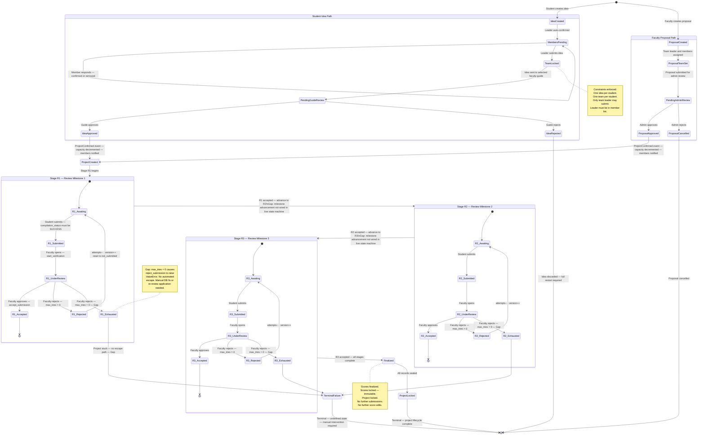

# Educational Capstone Portal — Project Lifecycle State Machine

This state diagram covers the complete lifecycle of a Educational Capstone Portal project from initial idea or proposal
creation through the three submission stages to final locking. It uses composite states to group
related sub-states and annotates known gaps where specified transitions are not yet implemented
in the live codebase.

---

## Notes

- **Two independent entry points** (`[*] --> IdeaCreated` and `[*] --> ProposalCreated`) reflect
  the two registration paths; both converge at `ProjectCreated`.
- **`IdeaRejected` is a true terminal**: the entire idea and team composition are discarded.
  Students must restart from scratch. Whether the team lock is released programmatically is
  **not specified** in the current implementation.
- **`ProposalCancelled` is a terminal** for the proposal; it is not defined as a restart for
  the faculty member (they may create a new proposal from the `[*]` initial state).
- **Stage advancement gap (`R1 → R2`, `R2 → R3`)**: the `project_reports` table supports
  `review_milestone ∈ {R1, R2, R3}` as distinct rows, but the live state machine
  (`state.py`) always defaults to `review_milestone = 'R1'` and contains no logic to create
  the next `ProjectReport` row on stage acceptance.
- **`TerminalFailure`**: when `max_tries` reaches 0, `reject_submission` raises a `ValueError`.
  The project is permanently stuck in `UNDER_VERIFICATION`. A `RereviewApplication → HOD`
  pathway exists in the coordinator module but is not connected to the submission state machine.
- **`ProjectLocked`**: represents the hard terminal state after R3 acceptance. In the current
  implementation, this is the absence of any guard-passing transition out of `ACCEPTED` plus
  the score-lock enforced by the `SERIALIZABLE` transaction.

---

## Business Rules

- `IdeaCreated → MembersPending`: leader's `confirmation_status` is immediately set to
  `confirmed`; all other members start as `pending`.
- `TeamLocked`: the student's global "one team" constraint becomes active; they cannot join
  another team until the idea is resolved.
- `PendingGuideReview → IdeaApproved`: fires `ProjectConfirmed` event, decrements guide
  capacity, enqueues notifications for all members.
- `R*_UnderReview → R*_Rejected` requires `max_tries > 0`; raises on `max_tries ≤ 0`.
- `R*_UnderReview → R*_Accepted` and `R*_UnderReview → R*_Rejected` are both gated on
  `submission_status == UNDER_VERIFICATION`.
- Scores are recorded and locked per version before the accept/reject decision; the locked
  score persists even if the submission is later rejected (the version is incremented, so the
  new attempt gets a fresh score slot).
- `ProjectLocked` (Finalized): no system guard currently prevents an admin from manually
  overriding the status via the admin service endpoints.

---

## Edge Cases

- **Concurrent approval of student idea and faculty proposal for the same team**: both paths
  could theoretically create separate `Project` records for overlapping student sets. The
  `student_project` membership uniqueness `(project_id, student_reg_no)` does not prevent a
  student from appearing in two different projects.
- **Guide reassignment at `PendingGuideReview`**: a `GuideReassigned` event exists but its
  interaction with an idea currently awaiting that guide's decision is undefined.
- **Member `removed` after `TeamLocked`**: a member who declines after the team is locked
  has `confirmation_status = removed` but remains in the idea's member list. The downstream
  project creation may include or exclude them depending on service logic.
- **Milestone reset on rejection**: if stage advancement is eventually implemented, the
  `max_tries` counter on the new `ProjectReport` row must be explicitly reset to 3; this is
  not automatic.
