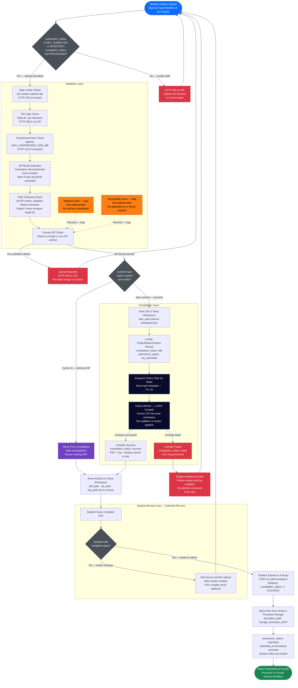

# Educational Capstone Portal — Report Processing Pipeline

This diagram details the complete technical pipeline that a student report traverses from ZIP
upload through security validation, LaTeX compilation, artifact generation, and the student
preview-edit loop before final submission to faculty. Future and unimplemented security checks
are marked explicitly.

---

## Notes

- **Validation is fully inline**: there is no separate "Security Scanner Service" as described in
  the requirements. All checks (ZIP-bomb, path-traversal, type, size, rate-limit, corrupt-ZIP)
  run within the `UploadService.accept_upload` method and `app/security/zip_validator.py`.
- **Malware and vulnerability scanning are unimplemented** (`Gap`). The system rejects ZIPs that
  are structurally dangerous (bomb/traversal) but does not scan for embedded malicious payloads
  or known CVEs.
- **Content-hash caching**: SHA-256 of the raw ZIP bytes is computed on upload. If the hash
  matches a prior successful compilation for the same project, the existing artifacts are reused
  without re-running the LaTeX compiler.
- **Temp vs. persistent storage**: compiled artifacts first land in a temp workspace keyed by
  `project_id_contentHash`. On student submission, they are copied to
  `PERSISTENT_STORAGE_DIR/project_id/vN`. If the temp directory is missing at submission time,
  the submission still proceeds (paths are null-safe).
- **SSE (Server-Sent Events)**: the student receives real-time compilation progress via a Redis-
  backed SSE stream. Task metadata (keyed `task:{uuid}:meta`) has a 2-hour TTL.
- **Free retries**: compilation failures do **not** decrement `max_tries`. Only faculty
  rejections consume an attempt.

---

## Business Rules

- Upload is only permitted when `submission_status ∈ {NOT_SUBMITTED, REJECTED}` **and**
  `compilation_status ≠ PROCESSING`. Any other combination returns HTTP 400 or 409.
- Only `.zip` files are accepted (type check on file extension). HTTP 400 otherwise.
- File size must be ≤ `MAX_COMPRESSED_SIZE_MB` (checked via `Content-Length` header; streams are
  validated on read). HTTP 413 otherwise.
- Rate limit is enforced per `user_id` (student registration number) via Redis.
- ZIP extraction aborts if the cumulative decompressed size exceeds the configured
  decompression-bomb threshold.
- Every entry in the ZIP is checked for path-traversal (`../`, absolute paths) before extraction.
- `submit_for_review` raises a `ValueError` if `compilation_status ≠ SUCCESS`. Students
  cannot submit a failed or in-progress compile.
- The `SELECT … FOR UPDATE` row lock in `_transition_to_idle` prevents concurrent uploads from
  the same project.

---

## Edge Cases

- **Upload during PROCESSING**: if a Celery task is already running and the student attempts
  another upload, the guard (`compilation_status == PROCESSING → HTTP 409`) blocks it.
- **Enqueue failure after commit**: if Redis is unavailable after the DB commit, the file is
  saved but the task is never dispatched. `rollback_after_enqueue_failure` attempts cleanup but
  cannot undo a committed transaction — the version row persists in an orphaned `idle` state.
- **Temp workspace missing at submission**: `shutil.copytree` is guarded by `tmp_path.exists()`;
  if the temp directory was cleaned up between compile and submit, paths are set to null. The
  submission still proceeds but the stored PDF path is empty.
- **Hash collision (identical ZIP, different content)**: SHA-256 collision probability is
  negligible but non-zero. A collision would serve a cached artifact for the wrong content.
- **Task metadata TTL**: if the student polls the SSE stream more than 2 hours after upload,
  the task metadata has expired and the stream cannot authenticate the request.
