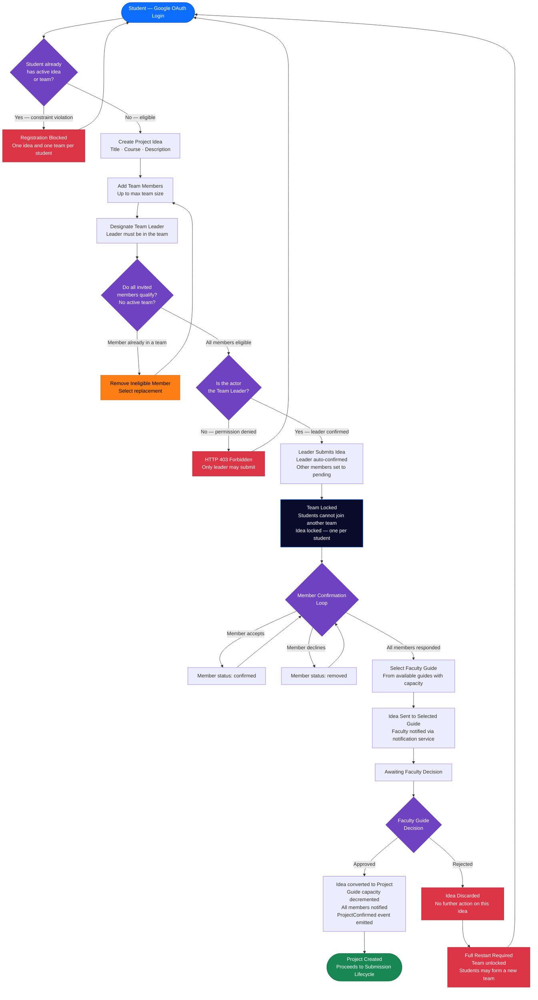

# Educational Capstone Portal — Student Project Registration Workflow

This diagram details the complete student-initiated project registration path: from Google
OAuth login through idea creation, team formation, member confirmation, faculty guide selection,
and the faculty approve/reject decision. It includes all enforced constraints and the full
restart path triggered by a faculty rejection.

---

## Notes

- **Leader auto-confirmation**: when the idea is submitted, the leader's `confirmation_status`
  is set to `confirmed` and `responded_at` is populated immediately. Other members start as
  `pending`.
- **Member confirmation is a handshake**: each non-leader member individually responds
  (`confirmed` or `removed`). The database enforces that `responded_at` is set for any
  non-pending status via a `CHECK` constraint.
- **Team lock semantics**: "team locked" means the `student_project` membership records are
  written and the student's global uniqueness constraint is engaged. The lock prevents the
  student from joining another team while the idea is active.
- **Guide capacity**: `FacultyGuideCapacity` is decremented on `ProjectConfirmed`. If capacity
  is exhausted and the decrement fails, a warning is logged but the confirmation proceeds —
  no rollback occurs.
- **Notification**: `ProjectConfirmed` fires an internal event that enqueues notifications for
  the guide and all team members via `notifications/writer`.
- **Restart path**: a faculty rejection discards the idea. Whether the team lock is
  automatically released is **not specified** in the current implementation — this requires
  clarification.

---

## Business Rules

- One active idea per student — creating a second idea while one is active is blocked.
- One team per student — a student in an active project cannot join another team.
- The team leader must be a member of the team (`leader_reg_no` must appear in the members list).
- Only the designated team leader may call the idea-submission endpoint (HTTP 403 otherwise).
- Members with an existing active team membership cannot be added to a new team.
- A student's `confirmation_status` on the idea must be `pending`, `confirmed`, or `removed`;
  any non-pending status requires `responded_at` to be set (database constraint).
- Faculty guide selection is constrained to guides with remaining capacity for the relevant
  `(academic_year, project_type)` combination.

---

## Edge Cases

- **Unconfirmed members at submission time**: the idea can be submitted by the leader while
  other members are still `pending`. Whether downstream operations (project creation, team
  lock) require all members to be confirmed is not enforced at the database layer.
- **Member declines after team lock**: a member who declines (`removed`) after the leader has
  submitted does not automatically unlock the team. The resulting team composition (with a
  `removed` member) is not explicitly handled.
- **Guide rejects — full restart**: on rejection, the idea is discarded. Whether the
  `student_project_idea_member` records (and associated team locks) are cleaned up is
  undefined in the current implementation.
- **Duplicate submission by leader**: a concurrent double-submit is not explicitly guarded at
  the idea-submission layer; the underlying uniqueness constraints on the idea table serve as
  the last line of defence.
