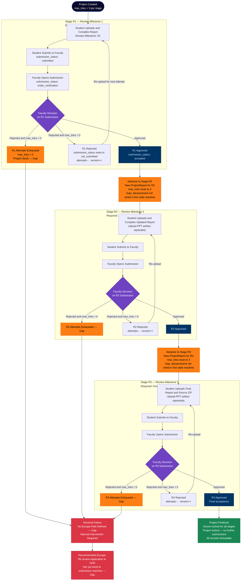

# Educational Capstone Portal — Submission Stage Workflow

This diagram shows the three-stage submission lifecycle (R1 → R2 → R3), the retry loop within
each stage, attempt-counter mechanics, and the terminal failure path when all attempts are
exhausted. Stage advancement is a specified requirement; the wiring between milestone completion
and the next stage's activation is currently a Gap in the live state machine implementation.

---

## Notes

- **Three stages map to `review_milestone ∈ {R1, R2, R3}`** on the `project_reports` table. Each
  stage has its own `ProjectReport` row (unique per `project_id, review_milestone`).
- **Stage advancement is a Gap**: the `ProjectReport` data model supports R1/R2/R3 as distinct
  rows, but the live state machine (`reports/services/state.py`) always defaults
  `review_milestone = 'R1'` and never advances the milestone. Milestone advancement must be
  wired to the `accept_submission` path.
- **Attempt counter (`max_tries`) is per version record** on `ProjectReportVersion`. It starts
  at 3 and is decremented on each faculty rejection. It is not reset automatically when a new
  stage begins (this reset must be implemented alongside stage advancement).
- **Source code for R3**: the spec requires source code as a deliverable for Stage 3. In the
  current model, source code is the uploaded ZIP itself (`zip_path` on the version record).
  There is no dedicated `source_code` artifact type — the `project_report_artifacts` table
  supports `ppt`, `poster`, `sdg_plan`, `outcome_plan`, `outcome_status`,
  `outcome_attainment_proof` but not `source_code`.
- **PPT for R2 and R3**: PPT is uploaded as a `ProjectReportArtifact` with
  `artifact_type = 'ppt'`. The uniqueness constraint `(report_version_id, artifact_type)`
  ensures one PPT per version.
- **Free compile retries**: the attempt counter is only decremented on faculty rejection.
  Compilation failures (LaTeX errors) are free retries with no attempt consumed.

---

## Business Rules

- Maximum **3 faculty-rejection attempts per stage** (`max_tries = 3` on `ProjectReportVersion`).
- Each faculty rejection: `max_tries -= 1`, `version += 1`, `submission_status → NOT_SUBMITTED`,
  `compilation_status → IDLE`.
- `reject_submission` raises `ValueError: Student has exhausted all 3 compilation attempts`
  if `max_tries ≤ 0`, leaving the project stuck in `UNDER_VERIFICATION`.
- `accept_submission` and `reject_submission` are both gated on
  `submission_status == UNDER_VERIFICATION`; any other state raises an error.
- `start_verification` (faculty opening) is gated on `submission_status == SUBMITTED`.
- Compilation can only start when `submission_status == NOT_SUBMITTED` (compile is blocked if
  a prior submission is pending review or accepted).
- Stage 1 artifact: compiled report PDF (in ZIP). Stage 2 adds PPT. Stage 3 adds source ZIP.

---

## Edge Cases

- **`max_tries == 0` deadlock**: the faculty cannot reject (exception thrown), the student
  cannot resubmit (submission is `UNDER_VERIFICATION`). The project is permanently stuck unless
  a manual database update or a re-review application mechanism (not yet wired) is invoked.
- **Stage advancement not implemented**: if R1 is accepted, no automatic mechanism advances the
  project to R2. The student would need to manually trigger R2 — the exact mechanism is
  undefined in the current codebase.
- **Version counter in legacy vs. new model**: the legacy `Project.version` (monotonic per
  project) differs from `ProjectReportVersion.version` (monotonic per `ProjectReport`). Both
  are incremented on rejection but may drift if not kept in sync during migration.
- **Accepted stage re-opened**: once `submission_status == ACCEPTED`, no guard prevents an
  admin from manually resetting the status via the admin service — there is no database-level
  immutability.
