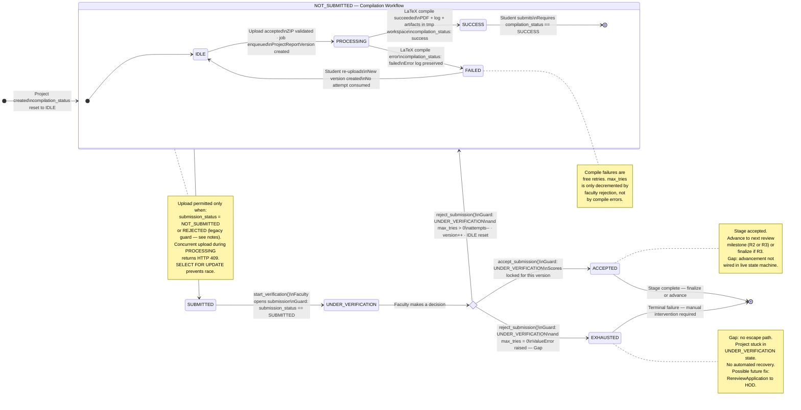

# Educational Capstone Portal — Submission State Machine

This diagram represents the **actual implementation** of the dual-axis state machine that governs
report submissions in the Educational Capstone Portal. Two orthogonal status fields exist on every project:
`compilation_status` (IDLE → PROCESSING → SUCCESS | FAILED) and `submission_status`
(NOT_SUBMITTED → SUBMITTED → UNDER_VERIFICATION → ACCEPTED). Their interaction — especially
the guards that enforce which transitions are legal — is the core of the submission workflow.

---

## Notes

- **`compilation_status` is a sub-state of `NOT_SUBMITTED`**: the LaTeX compilation workflow
  (IDLE → PROCESSING → SUCCESS | FAILED) operates entirely within the
  `submission_status = NOT_SUBMITTED` envelope. Once `submit_for_review` fires, the project
  enters `SUBMITTED` and all compile/re-compile paths are blocked.
- **`REJECTED` status is effectively dead**: the `SubmissionStatus` enum includes `REJECTED`,
  and the upload guard accepts `REJECTED` as a valid state for re-upload. However,
  `reject_submission` sets `submission_status = NOT_SUBMITTED` (not `REJECTED`). The
  `REJECTED` value is written only to `AuditLog.status`, never to `Project.submission_status`
  as a persisting resting state. This is a discrepancy between the enum and the implementation.
- **Two parallel models**: the legacy `app/models/project.py:Project` and the new
  `app/modules/reports/models/project_report_version.py:ProjectReportVersion` both carry
  `compilation_status` and `submission_status` fields with identical enum semantics. The live
  state machine (`state.py`) still writes to the **legacy model**. Both models must be kept in
  sync during the ongoing migration.
- **Serializable transaction for score locking**: `add_project_score` runs under
  `ISOLATION LEVEL SERIALIZABLE`. If a second score write is attempted for the same
  `(project_id, version)`, the unique constraint raises and the service returns
  HTTP 400 "Scores are locked."
- **State machine entry point**: `create_project` initialises
  `compilation_status = IDLE, submission_status = NOT_SUBMITTED, version = 1, max_tries = 3`.
  This is the canonical starting state.

---

## Business Rules

| Transition | Guard enforced in code |
|---|---|
| `IDLE → PROCESSING` | `submission_status == NOT_SUBMITTED` |
| `PROCESSING → SUCCESS` | Celery task completes without error |
| `PROCESSING → FAILED` | Celery task raises or returns failure |
| `FAILED → IDLE` | Re-upload with valid ZIP |
| `NOT_SUBMITTED → SUBMITTED` | `compilation_status == SUCCESS` |
| `SUBMITTED → UNDER_VERIFICATION` | `submission_status == SUBMITTED` |
| `UNDER_VERIFICATION → ACCEPTED` | `submission_status == UNDER_VERIFICATION` |
| `UNDER_VERIFICATION → NOT_SUBMITTED` | `submission_status == UNDER_VERIFICATION` AND `max_tries > 0` |
| `UNDER_VERIFICATION → EXHAUSTED` | `submission_status == UNDER_VERIFICATION` AND `max_tries ≤ 0` |

- Compile failures do **not** decrement `max_tries`.
- Each faculty rejection: `max_tries -= 1`, `version += 1`, reset both status fields to IDLE /
  NOT_SUBMITTED.
- `max_tries` starts at 3 (configured as `server_default="3"` on the model).
- Upload guard: `submission_status ∈ {NOT_SUBMITTED, REJECTED}` AND `compilation_status ≠ PROCESSING`.

---

## Edge Cases

- **`REJECTED` upload guard dead code**: the upload service accepts `REJECTED` as a valid
  `submission_status` for re-upload, but `reject_submission` never sets `REJECTED` as the
  resting state. This guard branch is currently unreachable.
- **Rollback after enqueue failure**: if Redis `enqueue` fails after the DB `commit` that
  created the version row, the version is left in an `idle/not_submitted` orphan state. The
  `rollback_after_enqueue_failure` helper attempts cleanup but cannot undo a committed
  transaction.
- **Concurrent `start_verification` calls**: if two faculty members open the same `SUBMITTED`
  submission simultaneously, both may pass the `submission_status == SUBMITTED` guard before
  either write completes. The result is two `UNDER_VERIFICATION` transitions — a race condition
  that the current `SELECT` (non-locking) does not prevent.
- **`max_tries` drift between models**: if the legacy `Project.max_tries` and the new
  `ProjectReportVersion.max_tries` are both being updated, a failure that rolls back one write
  but not the other leaves the counters out of sync.
